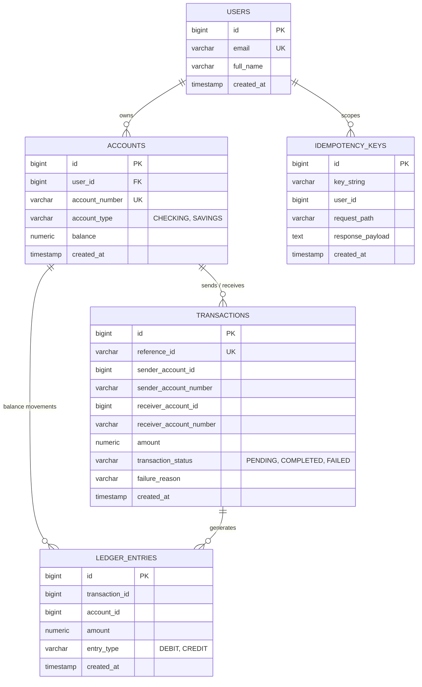
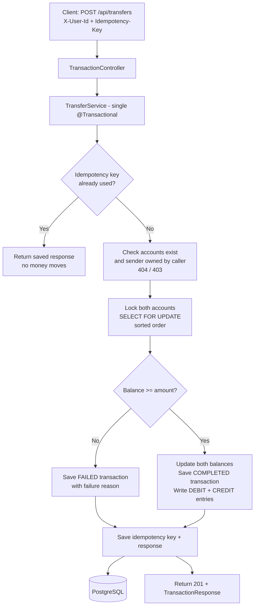

# Fincore Gateway

A fault-tolerant, double-entry financial ledger API built with Spring Boot. It keeps balances correct under concurrent transfers and retried requests.

## Features

- User registration and account creation (CHECKING / SAVINGS)
- Account-to-account transfers with a double-entry ledger (DEBIT + CREDIT)
- Safe concurrency: pessimistic locking prevents lost updates
- Idempotent transfers via the `Idempotency-Key` header
- Ownership checks: users can only act on their own accounts (403 otherwise)
- Paginated account statements, including failed attempts for the sender
- Consistent JSON error responses through a global exception handler

## Tech Stack

Java 17, Spring Boot 4, Spring Data JPA / Hibernate, PostgreSQL, Maven, Lombok, JUnit 5, AssertJ

## Key Engineering Decisions

- **Pessimistic locking.** Transfers lock both accounts with `SELECT ... FOR UPDATE`, always in sorted account-number order, so two opposite transfers cannot deadlock.
- **Atomicity.** The balance updates, the transaction record, both ledger rows and the idempotency record are written in a single `@Transactional` method. Any failure rolls everything back.
- **Idempotency.** The idempotency key is saved in the same transaction as the transfer. A unique constraint on (key, user, path) means two simultaneous identical requests cannot both succeed.
- **Failed transfers are data.** Insufficient funds produces a `FAILED` transaction with a `failure_reason` and no ledger rows. It is not thrown as an error.
- **Money handling.** `BigDecimal` in Java and `NUMERIC(19,4)` in Postgres, never floating point.
- **Information hiding.** Transactions are exposed through short public reference IDs and account numbers. Internal sequential IDs are never returned for transactions. A receiver's statement never shows a sender's failed attempt.
- **DTOs everywhere.** Entities are never returned directly, which avoids over-posting and lazy-loading serialization problems.

## Architecture

### Database Schema



### Transfer Flow



## API Endpoints

| Method | Endpoint | Headers | Purpose |
|---|---|---|---|
| POST | `/api/users` | | Register a user |
| POST | `/api/accounts` | `X-User-Id` | Create an account with an initial balance |
| GET | `/api/accounts/{id}/balance` | `X-User-Id` | Get an account's balance |
| POST | `/api/transfers` | `X-User-Id`, `Idempotency-Key` | Transfer money between accounts |
| GET | `/api/accounts/{id}/statement?page=0&size=10` | `X-User-Id` | Paginated transaction history |

### Example

```bash
curl -X POST http://localhost:8080/api/transfers \
  -H "Content-Type: application/json" \
  -H "X-User-Id: 1" \
  -H "Idempotency-Key: abc-123" \
  -d '{"senderAccountNumber":"ACC-XXXXX","receiverAccountNumber":"ACC-YYYYY","amount":2500}'
```

Sending the same request again with the same `Idempotency-Key` returns the saved response and does not move money a second time.

## Running Locally

1. Install Java 17 and PostgreSQL.
2. Create a database: `CREATE DATABASE fincore;`
3. Edit `src/main/resources/application.yaml` with your database URL, username and password.
4. Run:

```bash
./mvnw spring-boot:run
```

The API starts on `http://localhost:8080`. Hibernate creates the tables on first run.

## Testing

```bash
./mvnw test
```

`TransferConcurrencyTest` fires 50 simultaneous transfers of ₹500 from an account holding ₹5,000. It asserts that exactly 10 succeed, 40 fail with insufficient funds, and the final balance is exactly 0. Replacing the locking query with a plain read makes the test fail, which shows the lock is what protects the balance.

## Future Roadmap

- JWT authentication with Spring Security (currently a header-based placeholder for development)
- Docker and Docker Compose setup
- Flyway database migrations
